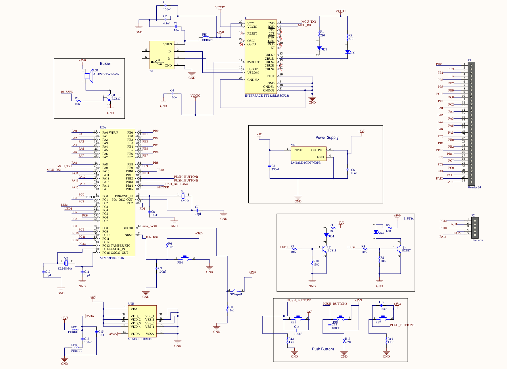
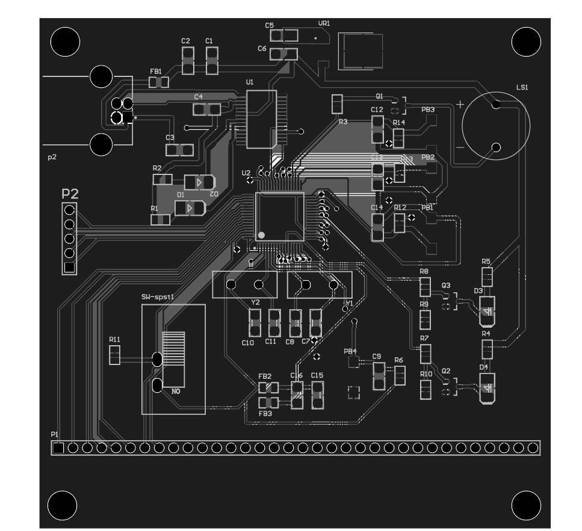

# STM32F103RET6 Evaluation Board — Hardware & PCB Design

A custom two-layer printed circuit board (PCB) and hardware schematic for an **STM32F103RET6 ARM Cortex-M3 microcontroller evaluation board**, designed using **Altium Designer**.

This project covers component selection based on datasheet specifications, schematic capture, PCB layout, component placement, routing, and copper polygon configuration. It was completed as part of an undergraduate engineering course.

## Project Status

- **Schematic design:** Completed
- **PCB layout:** Completed
- **Physical fabrication:** Not performed
- **Hardware testing:** Not performed

This repository documents the electronic design work completed as part of an undergraduate engineering course. The physical board has not been fabricated or experimentally validated.

## Schematic

The schematic illustrates the STM32F103RET6 microcontroller and its supporting circuits, including power regulation, clock generation, USB-to-serial communication, boot-mode selection, and reset circuitry.



## PCB Layout

The PCB layout shows component placement, copper routing, vias, and the two-layer board design.



## Key Hardware Features

- **Microcontroller:** STMicroelectronics STM32F103RET6, featuring an ARM Cortex-M3 core in an LQFP-64 package.
- **Clock System:**
  - **HSE:** External 8 MHz crystal with 18 pF load capacitors.
  - **LSE:** 32.768 kHz crystal for the real-time clock (RTC).
- **Power Regulation:**
  - **12 V DC input:** An LM78M05 linear regulator provides a 5 V regulation stage.
  - **USB power input:** A 5 V input option through the USB Type-C connector.
- **USB-to-UART Interface:** FT232RL USB-to-serial converter connected to the USB interface.
- **User Peripherals:**
  - Three user push buttons.
  - Dedicated reset push button and NRST circuitry.
  - Switch-controlled boot-mode selection.
  - 5 V buzzer driven by a BC817 NPN transistor.
  - SMD LEDs with transistor driver circuitry and current-limiting resistors.
- **Programming and Expansion:**
  - Dedicated ST-LINK/SWD programming header.
  - GPIO breakout through 2×40 SMD male pin headers.

## PCB Layout and Design Considerations

The PCB layout targets a two-layer board with dimensions of **90 × 90 mm**.

The documented design considerations include:

1. **Decoupling capacitors:** Placement of bypass capacitors near the microcontroller power pins.
2. **Power and ground distribution:** Copper polygon pours on the top and bottom layers for power and ground connections.
3. **Power routing:** Consideration of trace widths for power nets.
4. **Component placement and routing:** Component placement and signal routing, including correction of schematic connectivity and PCB layout errors encountered during design.
5. **Mechanical design:** Four corner mounting holes for potential enclosure integration.

These points describe the design approach and layout features. Signal integrity, return-path impedance, thermal performance, and manufacturing readiness have not been experimentally validated.

## Design Rule Checking (DRC)

The design process included addressing schematic connectivity and PCB layout errors. A completed Design Rule Check (DRC) report is not included in this repository; therefore, a fully error-free or manufacturing-ready PCB is not claimed.

## Bill of Materials

The following table summarizes key components used in the design.

| Component | Part Number / Value | Package | Qty | Description |
|---|---|---|---:|---|
| Microcontroller | STM32F103RET6 | LQFP-64 | 1 | ARM Cortex-M3 microcontroller |
| USB-to-UART IC | FT232RL | SSOP-28 | 1 | USB-to-serial interface |
| Voltage Regulator | LM78M05 | SMD | 1 | 5 V linear regulator |
| Transistor | BC817 | SOT-23 | 3 | NPN transistor for switching circuits |
| HSE Crystal | 8 MHz | HC-49US | 1 | High-speed clock source |
| LSE Crystal | 32.768 kHz | Verify package | 1 | RTC clock source |
| Buzzer | AI-1223-TWT-5V-R | SMD | 1 | Audio output |
| USB Connector | USB Type-C (C951) | SMD | 1 | USB interface and power input |
| Push Buttons | Tactile switches | SMD, 3 × 6 × 2.5 mm | 4 | Reset, boot, and user inputs |
| LEDs | SMD LEDs | 1210 | 5 | Power, TX/RX, and user indicators |
| Capacitors | Various values | Various | — | Clock, filtering, and decoupling |
| Resistors | Various values | 0805 | — | Current limiting and pull-up/pull-down networks |
| Pin Headers | 2 × 40 male header | SMD | 1 | GPIO breakout and expansion |

For the detailed component list, see [`bill of material.csv`](bill%20of%20material.csv).

## Repository Structure

```text
STM32F103-Evaluation-Board-PCB/
├── Images/
│   ├── Schematic.png
│   └── PCB_2D_Layout.png
├── pcb_micro.PrjPcb
├── Sheet1.SchDoc
├── PCB1.PcbDoc
├── bill of material.csv
└── README.md
```

- **`pcb_micro.PrjPcb`** — Altium Designer project file.
- **`Sheet1.SchDoc`** — Schematic document.
- **`PCB1.PcbDoc`** — PCB layout document.
- **`bill of material.csv`** — Bill of materials.
- **`Images/`** — Schematic and PCB layout images.

Additional files, such as a 3D PCB rendering, schematic PDF, or manufacturing outputs, can be added when available.

## Tools and Skills

- Altium Designer
- Electronic schematic design
- PCB layout and routing
- Electronic component selection
- Datasheet interpretation
- Hardware design documentation

## Author

**Parsa Ghorbani**

Electrical Engineering | Control Engineering
